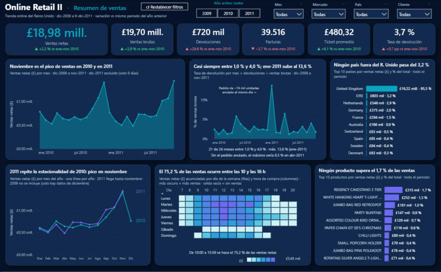
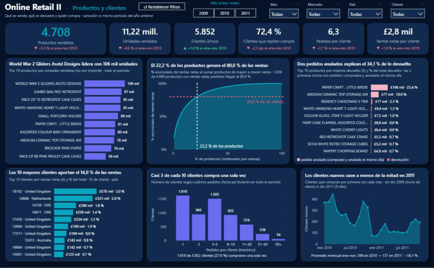
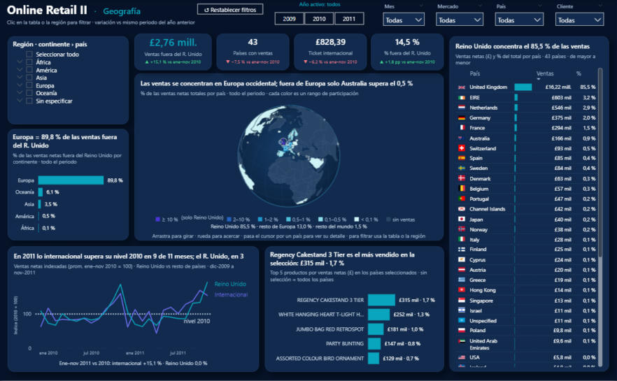

# Online Retail II · Análisis de ventas de una tienda online del Reino Unido

Proyecto completo de análisis de datos: desde el Excel original de más de un millón de filas hasta un dashboard descriptivo en Power BI, pasando por limpieza, reglas de negocio documentadas y un modelo estrella validado.

🔗 **Dashboard interactivo en vivo (Power BI):** **[Abrir en el navegador →](https://app.powerbi.com/view?r=eyJrIjoiNGQyMmYwYjEtOTAwNi00NTM2LWJlZjUtZWRiOWFiNmY5ZDZkIiwidCI6ImFjYTUxNjMxLTAwZmUtNDkwZC05MWFiLTE2M2VmODcyNjBlZSIsImMiOjR9)**



## Los datos

**Online Retail II** (UCI Machine Learning Repository): todas las transacciones de una tienda online británica de regalos y artículos para el hogar entre el **1-dic-2009 y el 9-dic-2011**. Muchos de sus clientes son mayoristas.

- 2 hojas de Excel con las mismas 8 columnas: `Invoice, StockCode, Description, Quantity, InvoiceDate, Price, Customer ID, Country`.
- **1.067.371 filas** en total (supera el límite de filas de una hoja de Excel).
- Problemas típicos: facturas de abono ("C"), cantidades negativas, clientes sin identificar (~23 %), precios en 0, códigos que no son producto (envío, comisiones, descuentos…) y descripciones con variantes.

## Proceso

| Paso | Qué se hizo | Carpeta |
|---|---|---|
| 0 | Excel (2 hojas) → un CSV de texto, conservando hoja y fila de origen para trazabilidad | `3_scripts` |
| 1 | Diagnóstico y limpieza. Las correcciones de formato se aplicaron directamente; las de contenido se decidieron y documentaron una por una | `2_datos_limpios`, `4_documentacion` |
| 2 | Clasificación de cada línea con reglas de negocio versionadas (`reglas_retail.yaml`): venta, devolución, cargo no producto, ajuste, sin valor | `2_datos_limpios`, `4_documentacion` |
| 3 | Modelo estrella: `fact_ventas` + `dim_producto`, `dim_cliente`, `dim_pais`, `dim_fecha`, con validación de integridad | `2_datos_limpios` |
| 4 | Exportación a Parquet, diccionario de datos y guía de carga con Power Query | `2_datos_limpios`, `4_documentacion` |
| 5 | Revisión independiente: todas las cifras recalculadas desde el Excel cuadran al centavo | `4_documentacion` |
| 6 | Dashboard descriptivo en Power BI (3 páginas) | `5_power_bi` |

### Decisiones de limpieza más importantes

- **Filas duplicadas entre hojas:** las 22.523 filas del 1 al 9 de diciembre de 2010 aparecían idénticas en las dos hojas. Se conservó una sola copia y la otra se movió a `filas_excluidas.csv` con su motivo.
- **Nada se borra sin dejar rastro:** devoluciones, cargos y ventas sin cliente se **clasifican**, no se eliminan; las medidas DAX deciden qué sumar.
- **Valores dudosos se conservan y se marcan** (`alerta_*`): descripciones vacías, duplicados dentro de una misma hoja y volúmenes extremos.
- **Pedidos anulados:** dos pedidos gigantes (≈74 mil y ≈81 mil unidades) se compraron y anularon el mismo día; explican el 34,1 % del importe devuelto y el dashboard los señala aparte.

### Cuadre de control

| Concepto | Valor |
|---|---:|
| Filas del Excel | 1.067.371 |
| Filas excluidas (duplicado entre hojas) | 22.523 |
| Filas del modelo | 1.044.848 |
| Ventas brutas | £19.699.799,72 |
| Devoluciones | £719.656,34 |
| **Ventas netas** | **£18.980.143,38** |
| Facturas | 39.516 |
| Clientes identificados | 5.852 |

## Dashboard (Power BI)

Tres páginas con el mismo diseño. Cada gráfico tiene un título con la conclusión, un subtítulo que explica qué mide y, cuando hace falta, una nota con la cifra exacta. Los títulos son **dinámicos**: se recalculan con cualquier filtro y pasan a una frase neutral si el hallazgo deja de ser cierto.

1. **Resumen de ventas:** KPIs con variación frente al mismo periodo del año anterior, tendencia mensual, tasa de devolución, países, estacionalidad, mapa de calor día × hora y top de productos.
2. **Productos y clientes:** productos más vendidos, curva de Pareto, devoluciones (con los pedidos anulados identificados), mayores clientes, frecuencia de compra y clientes nuevos.
3. **Geografía:** globo terráqueo 3D interactivo, ventas por continente, mercado británico frente al internacional (índice base 100), top 5 por selección y tabla de países.

Filtros sincronizados en las tres páginas (año, mes, mercado, país, cliente con búsqueda) y botón **Restablecer filtros**.

### Hallazgos principales

- El **Reino Unido concentra el 85,5 %** de las ventas; fuera de Europa solo Australia supera el 0,5 %.
- **Noviembre es el pico** de ventas en 2010 y en 2011 (campaña navideña).
- El **75,2 %** de las ventas ocurre entre las 10 y las 16 h; el sábado casi no hay ventas.
- El **22,2 %** de los productos genera el 80 % de las ventas.
- **Casi 3 de cada 10 clientes** compran una sola vez, y los **clientes nuevos caen a menos de la mitad** en 2011.
- En 2011 lo **internacional supera su nivel de 2010 en 9 de 11 meses**; el Reino Unido, solo en 3.




## Estructura de la carpeta

```
1_datos_originales/     Excel original (sin modificar)
2_datos_limpios/
   csv_limpio/          CSV limpio (comprimido en .zip) + filas excluidas con su motivo
   lineas_clasificadas/ cada línea con su tipo (venta, devolución, cargo…)
   modelo_estrella/     tablas Parquet que usa Power BI
3_scripts/              código Python de cada paso (conversión, limpieza, reglas, modelo, exportación)
4_documentacion/        reportes de limpieza y reglas, reglas de negocio (YAML), diccionario de datos,
                        guía de Power Query, medidas DAX, validación del modelo e informe de control de calidad
5_power_bi/             archivo .pbix listo para publicar en Power BI Service
6_capturas_dashboard/   imágenes de las tres páginas
```

> **Nota sobre los datos:** el Excel original (`1_datos_originales/`, 44 MB) y los archivos intermedios pesados no se versionan en este repositorio. Descarga el dataset desde [UCI Machine Learning Repository](https://archive.ics.uci.edu/dataset/502/online+retail+ii) y regenera todo el pipeline con los scripts de `3_scripts/`. El modelo estrella en Parquet y el `.pbix` sí están incluidos.

## Cómo abrirlo

- **Dashboard en vivo (Power BI Service):** 👉 **[Abrir el tablero interactivo →](https://app.powerbi.com/view?r=eyJrIjoiNGQyMmYwYjEtOTAwNi00NTM2LWJlZjUtZWRiOWFiNmY5ZDZkIiwidCI6ImFjYTUxNjMxLTAwZmUtNDkwZC05MWFiLTE2M2VmODcyNjBlZSIsImMiOjR9)** — se ve e interactúa en el navegador, sin instalar nada.
- **Archivo `.pbix`:** `5_power_bi/Online Retail II - Dashboard descriptivo.pbix` en Power BI Desktop. El botón "Restablecer filtros" se activa con Ctrl + clic.
- **Scripts:** Python 3 con `pip install -r 3_scripts/requirements.txt`.

## Herramientas

Python (pandas, pyarrow, openpyxl) · Power BI Desktop · Power Query · DAX · Vega (globo 3D con el visual Deneb)
